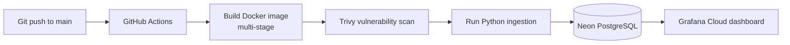

# Sentinel: Cloud-Native DevSecOps Data Pipeline
 
A data pipeline that ingests real-time cryptocurrency market data from a public REST API, stores it in a serverless PostgreSQL database, and monitors it with Grafana Cloud. The whole lifecycle (build, security scan, run) is automated with GitHub Actions.
 
I built this to practice the full DevOps flow end to end: containerization, CI/CD, security scanning, secret management, and observability.
 
## Architecture
 

 
| Layer | What it does |
|---|---|
| Ingestion | Python service that fetches market data from a public REST API |
| Storage | Neon serverless PostgreSQL, connected over SSL |
| Automation | GitHub Actions workflow handles build, scan and execution |
| Security | Trivy scans the Docker image for Critical and High CVEs |
| Observability | Grafana Cloud dashboard shows ingestion activity and market trends |
 
## Tech Stack
 
- **Language:** Python 3.9
- **Database:** PostgreSQL (Neon serverless)
- **Containers:** Docker (multi-stage build)
- **CI/CD:** GitHub Actions
- **Security scanning:** Trivy
- **Monitoring:** Grafana Cloud
 
## Project Structure
 
```
.
├── .github/workflows/   # CI/CD pipeline (devops-pipeline.yml)
├── app/                 # Python ingestion code
├── docker/              # Dockerfile
├── sql/                 # Database schema and queries
└── README.md
```
 
## How the Pipeline Works
 
1. A push to `main` triggers the GitHub Actions workflow.
2. The workflow builds the Docker image using a multi-stage Dockerfile.
3. Trivy scans the image for Critical and High severity vulnerabilities.
4. The container runs the Python ingestion, which fetches data from the API and writes it to Neon.
5. Grafana Cloud reads from the database and displays the dashboard.
 
## Key Implementations
 
**Multi-stage Docker build.** Build tools stay in the first stage, and the final image contains only what is needed to run. This keeps the image small and reduces the attack surface.
 
**Security scanning in CI.** Trivy scans every build for known vulnerabilities before the application runs.
 
**Secret management.** The database connection string is stored as an encrypted GitHub Secret (`DATABASE_URL`) and is never committed to the repository. Database connections use SSL.
 
**Observability.** A Grafana Cloud dashboard tracks how often data is ingested and shows market trends, so a stopped pipeline is easy to spot.
 
## Challenge: Moving to the Cloud
 
During development, my local WSL and Docker environment became corrupted and I could no longer build containers on my laptop. Instead of pausing the project, I moved the entire workflow to GitHub Actions so builds and scans run on GitHub's runners. This made the pipeline reproducible and independent of my local machine, and it taught me why cloud-based CI is more reliable than "it works on my machine".
 
## Setup
 
### Requirements
- Python 3.9+
- A Neon (or any PostgreSQL) database
 
### Run locally
```bash
pip install -r app/requirements.txt
export DATABASE_URL='your_connection_string'
python app/main.py
```
 
### Run in GitHub Actions
1. Go to **Settings → Secrets and variables → Actions**.
2. Add a secret named `DATABASE_URL` with your PostgreSQL connection string.
3. Push to `main`. The workflow in `.github/workflows/devops-pipeline.yml` runs automatically.
 
## Limitations and Next Steps
 
This is a learning project built with production practices, not a production system. Planned improvements:
 
- [ ] Fail the pipeline automatically when Trivy finds serious vulnerabilities
- [ ] Add automated tests before the build step
- [ ] Run ingestion on a schedule (cron) instead of only on push
- [ ] Add Grafana alerts for when ingestion stops
- [ ] Deploy as a container on Cloud Run or Kubernetes
 
## Author
 
**B R Medhini** · [LinkedIn](https://www.linkedin.com/in/br-medhini/) · [GitHub](https://github.com/medhinibr)
